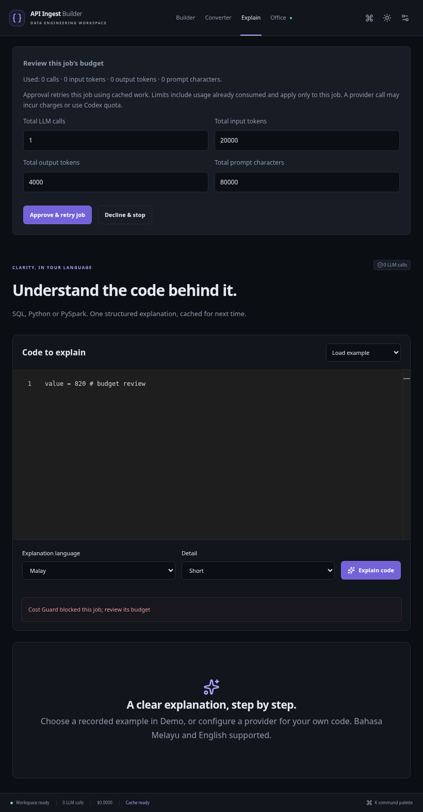

# Phase 7 release verification

Validated on 24 October 2026 in a fresh Linux cloud checkout of Phase 6 (`108b083`), using Python 3.12, Node 24, frozen lockfiles and a disposable production container. No personal data volume, real API key, Codex login files or live inference calls were used.

| Check | Evidence |
| --- | --- |
| `make test` | 163 backend tests pass, including six budget integration tests; TypeScript and 22 Office unit checks pass. |
| `make lint` | Ruff checks/formatting and TypeScript pass. |
| Production build | Next.js static export and the multistage Docker image build successfully. |
| Production container smoke | HTTP/static export, first-run onboarding, explicit Demo, masked settings, durable SSE, non-root execution, no Node/Codex/Playwright in the default runtime. SQLite settings survive container restart. |
| Browser → API → SQLite → UI | 10 Playwright scenarios pass against the production container at 1440px and 820px: Builder research/cache/download, deterministic conversion and sample verification, recorded Explain, Office replay/inspector/PiP, budget recovery from history after reload, decline without provider calls, and approved response rendering. |
| Budget execution | Real application routes with mocked provider transports verify research and converter retries, Codex nullable accounting, restart recovery, retained cumulative usage, unchanged global limits, duplicate decision rejection, concurrent claims, transient-key exclusion, provider changes, cross-origin rejection and safe provider errors. Browser approval rendering uses a mocked response, so no real inference is triggered. |
| Secret audit | Existing repository audit passes for tracked content/history, ignored credentials/data and hardcoded model literals. No `.env` or Codex authentication file was read. |

The cloud proxy requires its CA trust bundle during dependency downloads. Docker validation used a temporary copy of the project Dockerfile with BuildKit CA secret mounts for npm/pnpm/uv, retaining TLS verification. The session CA and temporary Dockerfile are not committed or copied into the runtime image. The app itself uses the repository Dockerfile and no environment-specific configuration is required on an ordinary machine. System Chromium was selected through `PW_CHROMIUM_EXECUTABLE_PATH` because the browser download domain is unavailable in this environment.

The checks found and fixed a tablet overflow when budget review appeared, a stale Office budget barrier after decisions, and unreadable runtime source/static files when the build context uses a restrictive umask. Docker now grants runtime read access before switching to the non-root user. Research SSE finishes only after the blocked result is persisted, allowing the UI to recover it reliably.

## Operating limits

- Live CoinGecko/Frankfurter ingestion and real provider/Codex inference were not exercised. Existing HTTP fixtures and mocked provider transports verify behavior; users must configure their own provider and target credentials for a live run.
- No target API or LLM calls are made merely by approving a recorded Office replay. Live budget approval is explicit and scoped to one persisted job.
- Budget retries restart the operation with cached LLM responses and retained reservations. They may re-fetch docs. A further limit breach requires a new approval. Changing providers requires a new job. Jobs interrupted during active execution are not automatically resumed.
- Transient research keys are omitted from retry payloads. Save host-bound target credentials through the UI before retrying authenticated verification.
- The optional JS-rendering image, a real Spark runtime and Windows PowerShell execution were not run in this Linux validation. Their existing mocked/syntax checks remain in place.
- FastAPI's current test client emits an upstream Starlette/httpx deprecation warning; all tests pass. No dependency or lockfile changes were needed.

## Reproduce

Run `make test`, `make lint`, `make build`, then `python scripts/smoke_docker.py` after building the normal Compose image. On Windows use the matching scripts under `scripts/`. `SMOKE_IMAGE` selects another already-built image for the disposable container check.

For the combined isolated gate, install Chromium with `pnpm --dir frontend exec playwright install chromium`, then run `make gate` or `.\scripts\gate.ps1`. The gate uses `.env.example` explicitly, creates and removes its own Compose project/volume, and must run while port 8000 is free. The browser suite may also run against a disposable instance via `PW_BASE_URL` and `PW_CHROMIUM_EXECUTABLE_PATH`.

